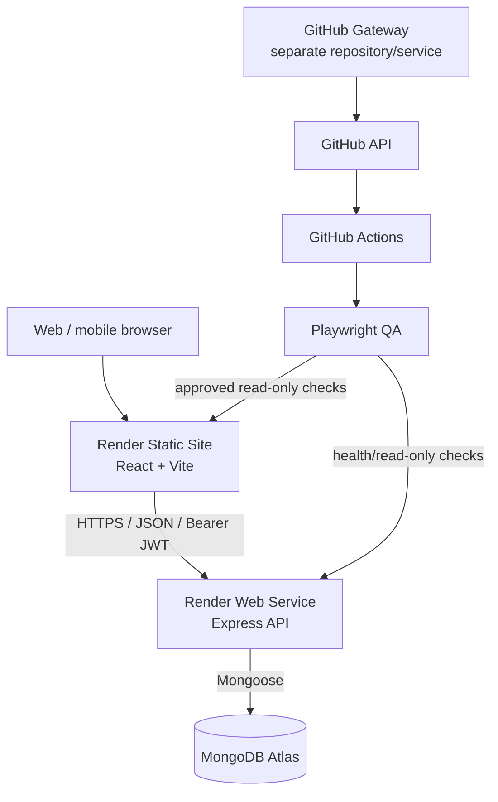
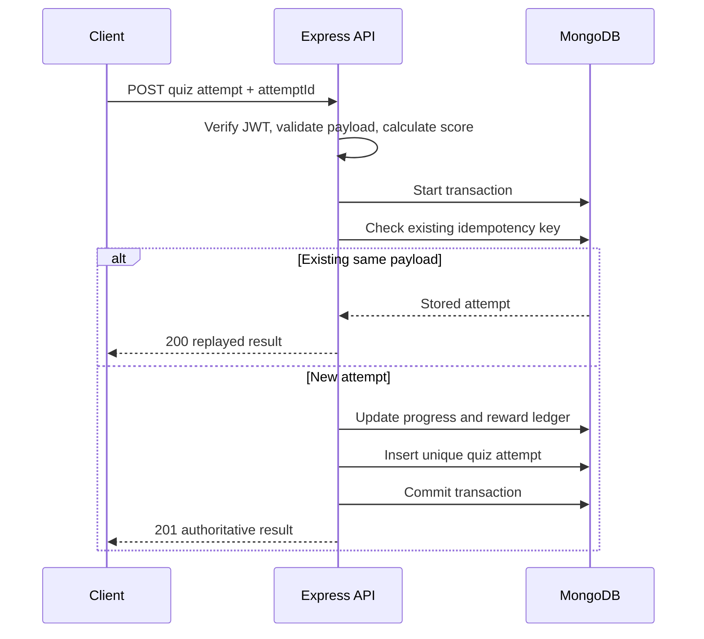

# HOC TAP QUEST — System Architecture

**Status:** Architecture baseline and target design  
**Repository:** `chienmkt2018-bit/hoctap`  
**Last reviewed:** 2026-11-05

This document distinguishes the architecture observed in the repository from planned scale-up capabilities. A proposed capability is not considered implemented until code, configuration, and tests demonstrate it.

## 1. Product and system boundaries

HOC TAP QUEST is a gamified learning application. The learner-facing product owns lesson navigation, quiz submissions, progress, XP, achievements, daily quests, and learning streaks.

The application repository is separate from the HOC TAP QUEST GitHub Gateway repository. The Gateway is an operator automation boundary; it is not part of the learner request path and must not become a dependency of the public learning API.

### Runtime context



The Gateway-to-GitHub path is operational automation and is intentionally separate from learner traffic.

## 2. Technology baseline

| Area | Current repository baseline |
|---|---|
| Frontend | React 19, TypeScript, Vite |
| Backend | Node.js, Express 5, TypeScript |
| Persistence | MongoDB Atlas, Mongoose |
| Authentication | bcryptjs password hashing, JWT bearer access token |
| API contract | OpenAPI 3.1 at `docs/openapi.yaml` |
| CI / QA | GitHub Actions, Node test runner, Playwright |
| Hosting | Render Static Site + Web Service |
| Browser state | Account-scoped and guest local progress; access token in sessionStorage |

Do not introduce a new framework, database, cache, message broker, or service boundary without a measurable requirement and a migration plan.

## 3. Deployment topology

### Environments

| Environment | Frontend | API | Branch |
|---|---|---|---|
| Production | `https://hoctap-frontend.onrender.com` | `https://hoctap-6oeu.onrender.com` | `main` |
| Staging | `https://hoctap-staging-frontend.onrender.com` | `https://hoctap-staging-api.onrender.com` | `staging` |

These URLs and branch mappings are repository operating records, not live health assertions. Before any release, verify Render service settings, deployed commit SHA, environment variables, logs, and health response.

### Release flow

1. Work on an isolated feature or maintenance branch.
2. Run frontend/backend build, unit/integration tests, and OpenAPI validation in GitHub Actions.
3. Review the complete diff and evidence.
4. Open a draft PR to the intended integration branch.
5. Promote to staging only after explicit approval.
6. Verify staging deployed SHA and scoped QA.
7. Promote to production only after a separate approval and production release checklist.

A PR or green CI run does not itself authorize merge or deployment.

## 4. Application architecture

The current backend is a **modular monolith**. Keep this topology while clarifying module boundaries.

### Target logical layers

```text
frontend/
  src/
    app/                 # routing, composition, application shell
    features/            # dashboard, quest-map, lessons, quiz, progress
    shared/              # reusable UI, API client, validation, utilities

backend/
  src/
    http/                # Express app, routes, middleware, error mapping
    modules/
      auth/              # registration, login, JWT identity
      learning/          # lessons, quiz submission and scoring
      progress/          # learner progress reads and updates
      gamification/      # XP, streak, daily quest, reward rules
    infrastructure/
      database/          # Mongoose connection and lifecycle
      observability/     # structured logs, metrics, tracing adapters
    shared/              # domain errors, schemas, shared types
    server.ts            # process entry point
  test/
    unit/
    integration/
```

This is a target organization, not a claim that all folders currently exist. Refactor incrementally; do not move files solely to match a diagram.

### Module ownership

| Module | Owns | Must not own |
|---|---|---|
| Auth | Password hashes, account identity, token verification | XP or lesson completion |
| Learning / Quiz | Quiz catalog, server scoring, attempt lifecycle | Client-authoritative scores |
| Progress | Learner progress projection and preferences | Reward policy |
| Gamification | XP formula, streak and reward eligibility | Authentication or HTTP concerns |
| Infrastructure | Database connection, indexes, logging | Product business rules |
| Frontend features | Presentation and user interaction | Authoritative XP or access control |

## 5. API boundaries

Base path: `/api/v1`.

| Method | Endpoint | Responsibility |
|---|---|---|
| GET | `/health` | API/database health |
| POST | `/auth/register` | Create account and issue access token |
| POST | `/auth/login` | Verify credentials and issue access token |
| GET | `/auth/me` | Resolve authenticated learner |
| GET | `/progress` | Read learner progress; must not create or mutate records |
| PUT | `/progress` | Update only explicitly permitted display preferences/statuses |
| POST | `/quizzes/{quizId}/attempts` | Validate and score a quiz attempt on the server |

OpenAPI is the API contract. Changes to request fields, response fields, status codes, authentication, or semantics must update implementation, contract, and tests together.

## 6. Data model and invariants

Observed persistence models include:

- **User:** normalized email, password hash, IANA timezone.
- **Progress:** total XP, completed lesson IDs, learning dates, daily activity, best XP per lesson, quest statuses.
- **QuizAttempt:** learner ID, idempotency key, request fingerprint, quiz result, XP result.
- **RewardLedger:** learner ID, reward source, deterministic idempotency key, XP amount.

### Authoritative data rules

1. The authenticated learner ID comes from a verified JWT, never from a client-supplied owner field.
2. The server owns answer keys, scoring, XP calculations, completion evidence, and reward eligibility.
3. A quiz retry with the same learner, attempt ID, and payload returns the stored result without awarding XP again.
4. Reusing an attempt ID with a different payload returns a conflict.
5. Progress, attempt, and reward writes that must be atomic use MongoDB transactions.
6. Unique indexes are the final concurrency guard for attempt and reward idempotency.
7. Browser guest progress is not automatically trusted or merged into authenticated server progress.
8. Read endpoints must not create or mutate learner records.

### Transaction boundary



A duplicate-key race must resolve by reading the existing record and validating the request fingerprint. It must never grant XP twice.

## 7. Security architecture

### Controls observed in source

- bcryptjs password hashing.
- JWT issuer/audience verification and one-hour access token lifetime.
- Authenticated endpoints use bearer-token middleware.
- Helmet security headers.
- CORS origin allowlist.
- JSON body size limit.
- Authentication rate limiting.
- Server-side validation and server-authoritative quiz scoring.
- Database connection errors avoid printing connection strings.

### Required production controls

- Keep JWT secrets and MongoDB credentials only in Render environment settings or approved secret stores.
- Never expose secrets in Vite variables, client bundles, Git history, workflow output, screenshots, or test artifacts.
- Keep ownership checks in server handlers for every learner-specific resource.
- Add endpoint-specific abuse controls for expensive or reward-bearing operations based on observed traffic and abuse risk.
- Use least-privilege database users and restrict network access to the minimum operationally possible.
- Define token revocation/session invalidation requirements before introducing refresh tokens.
- Review dependency advisories and pin/lock dependency resolution for reproducible builds.

Do not weaken authentication, authorization, CORS, validation, or rate limits to make a test pass.

## 8. Reliability and scalability strategy

### Scale in stages

**Stage A — Current modular monolith**
- Keep frontend static and backend stateless.
- Use MongoDB Atlas as the persistent source of truth.
- Keep all per-request state in the database or request context, not process memory.
- Use indexes for learner-scoped lookups and unique idempotency constraints.

**Stage B — Measured optimization**
- Inspect query plans and slow-query evidence.
- Paginate any growing history/list endpoint.
- Return projections instead of full documents.
- Cache only stable, non-sensitive catalog/configuration data when hit rate and invalidation rules justify it.
- Add request correlation IDs, structured logs, latency/error metrics, and alert thresholds.

**Stage C — Horizontal API scaling**
- Run multiple stateless API instances behind the hosting platform.
- Confirm transaction support and index readiness on the Atlas topology.
- Apply explicit connection-pool budgets per instance so aggregate connections remain within Atlas limits.
- Use bounded request timeouts and graceful shutdown.
- Verify concurrency/idempotency under multiple API instances.

**Stage D — Optional asynchronous services**
- Add a queue only for work that can be processed asynchronously, such as email, analytics export, or future AI jobs.
- Define retries, dead-letter handling, idempotency, and observability before introducing workers.
- Split a domain into a separate service only when independent scaling, ownership, deployment cadence, or fault isolation justify the operational cost.

Redis, Kafka, microservices, and Kubernetes are not default requirements for the current product.

## 9. Quality strategy

| Test layer | Required evidence |
|---|---|
| Unit | Domain rules: XP, dates, reward eligibility, validation |
| Integration | API + isolated MongoDB replica set; auth, ownership, transactions, idempotency |
| Concurrency | Same-key retries, changed payload conflict, competing transactions |
| Contract | OpenAPI lint and implementation/contract consistency |
| Frontend build | TypeScript check and Vite production build |
| Browser E2E | Scoped Playwright flows with environment and write guards |
| Production smoke | Approved read-only checks only unless a separate write-test approval exists |

Every test report must record environment, commit SHA, preconditions, steps, expected result, actual result, status, and evidence.

Statuses:
- **PASS:** observed expected behavior with evidence.
- **FAIL:** observed incorrect behavior or reproducible failure.
- **BLOCKED:** missing access, environment, tool, or evidence.

A successful page load is not proof that the whole application is production-ready.

## 10. Operational readiness gaps

The following are target controls that require separate implementation and verification; they must not be described as already complete:

- Structured application logging with request correlation IDs.
- Service-level metrics and alerting for latency, error rate, database saturation, and transaction failures.
- Explicit API request timeout and graceful shutdown behavior.
- Backup/restore rehearsal and documented recovery objectives.
- Database index migration/reconciliation procedure.
- Dependency update and vulnerability review cadence.
- Load-test baseline and capacity thresholds.
- Rollback runbook tied to deployed commit SHA.

## 11. Decision record

| Decision | Rationale |
|---|---|
| Keep modular monolith | Existing product is still evolving; service separation adds operational cost without measured bottlenecks |
| Keep MongoDB as source of truth | Existing progress, attempts, and rewards depend on atomic document/transaction behavior |
| Keep XP server-authoritative | Prevent client tampering and duplicate rewards |
| Keep read endpoints side-effect free | Predictable HTTP semantics, safe retries, simpler QA and caching |
| Use GitHub Actions for repeatable QA | Reproducible environment and auditable evidence |
| Do not auto-merge or auto-deploy | Production changes require explicit release approval |

## 12. Release gate

A production release candidate requires all of the following:

- [ ] Correct base branch and reviewed diff.
- [ ] Frontend type-check and production build pass.
- [ ] Backend type-check and production build pass.
- [ ] Unit and isolated integration tests pass.
- [ ] OpenAPI lint passes.
- [ ] Relevant Playwright tests pass in the approved environment.
- [ ] No unresolved critical/high security findings.
- [ ] Render deployed SHA and environment configuration verified.
- [ ] MongoDB backup/recovery and transaction topology reviewed.
- [ ] Rollback plan and release approval recorded.

Until each applicable item has evidence, the release status remains **not yet production-ready**.
